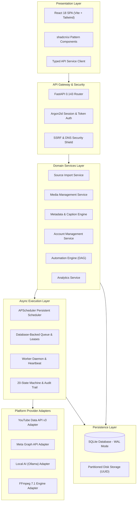
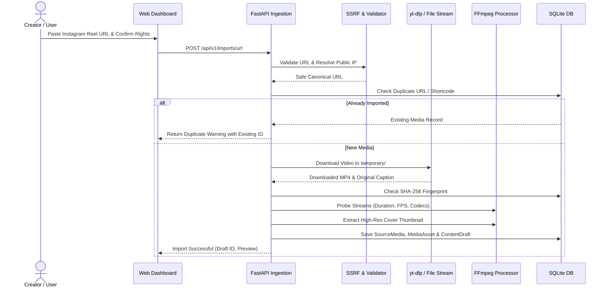
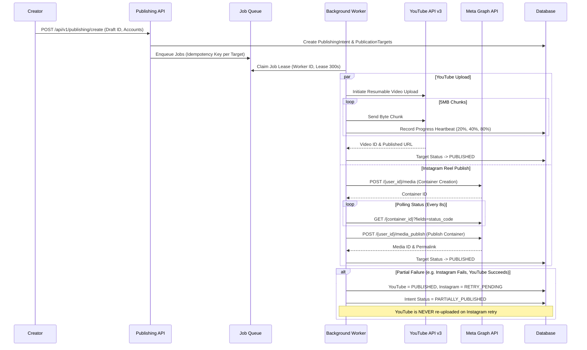

# System Architecture Specification — SocialRelay

**Version**: 1.0.0  
**Scope**: Full-Stack Modular Self-Hosted System Architecture  

---

## 1. Architectural Layers & Separation of Concerns

SocialRelay is structured into 18 independent, decoupled layers to ensure zero vendor lock-in, maintainability, and high reliability:

---

## 2. End-to-End Ingestion & Processing Flow

The end-to-end ingestion pipeline takes an authorized Instagram Reel link or local file, performs security validation, probes video metadata, and prepares platform-specific content:

---

## 3. Resilient Multi-Platform Publishing Sequence

The publishing process executes with strict idempotency and independent destination error tracking:

---

## 4. Decoupled Provider Adapter Pattern

All platform-specific logic is encapsulated in isolated adapters:
- **`api/app/providers/youtube/adapter.py`**: Handles Google OAuth2, channel queries, chunked resumable video uploads, and quota error mapping.
- **`api/app/providers/instagram/adapter.py`**: Handles Meta Graph API OAuth, Reels container initialization, status polling, and manual export fallback packaging.
- **`api/app/services/media/processor.py`**: Wraps the bundled FFmpeg 7.1 executable with array-based arguments.

A failure or API change in one provider does not affect the operation of other providers.
