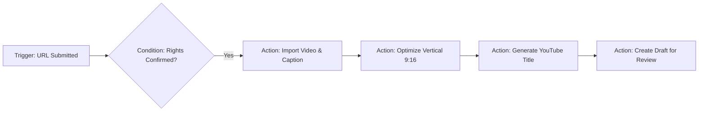
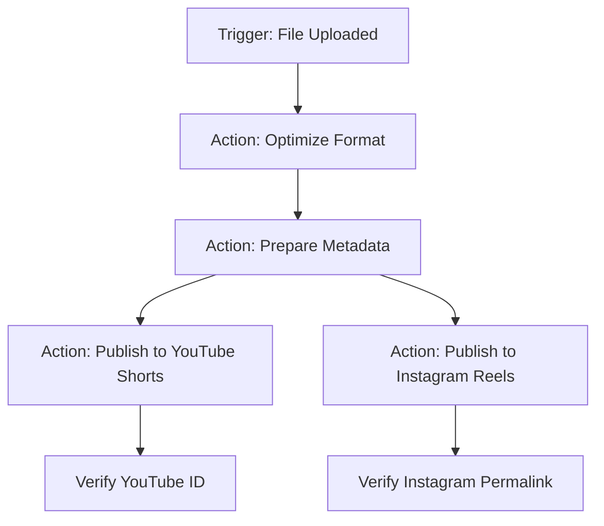
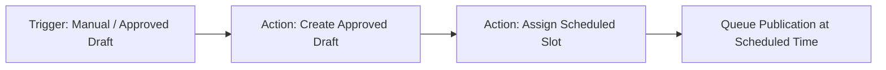
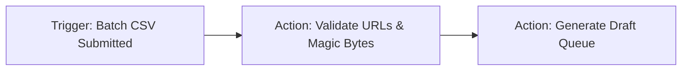
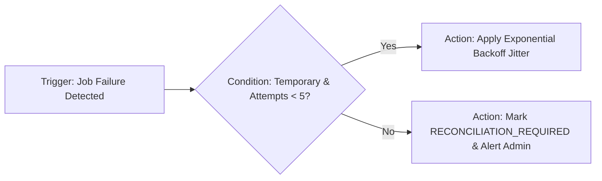
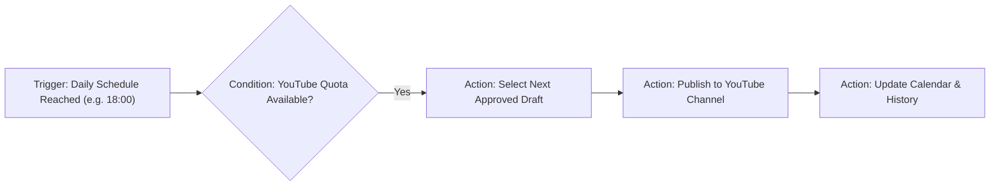

# Automation Workflows Specification — SocialRelay

SocialRelay includes a native, database-backed DAG (Directed Acyclic Graph) workflow engine that evaluates triggers, conditions, and actions without external automation platforms.

---

## 1. DAG Workflow Engine Principles

1. **Cycle Prevention**: Workflows are verified via Kahn's topological sort algorithm before activation. Circular dependencies are rejected with `WorkflowValidationError`.
2. **Deterministic Evaluation**: Nodes execute sequentially or in parallel branches based on edge definitions.
3. **Dry-Run Mode**: Every workflow can be evaluated safely in simulation mode with mock or test input.
4. **Audit Logging**: Every execution records execution status (`running`, `completed`, `failed`), step logs, and outputs in `automation_runs`.

---

## 2. Pre-Built Production Automation Templates

### Template 1: Instagram to YouTube Automation
Imports an authorized Instagram Reel, validates rights, optimizes to 1080×1920 vertical video, generates a YouTube title, and creates an approved draft.

---

### Template 2: Cross-Platform Publishing
When a video file is uploaded, optimize the video, prepare platform-specific metadata, and publish simultaneously to YouTube Shorts and Instagram Reels.

---

### Template 3: Scheduled Distribution
Assigns an approved draft to a designated future time slot in the content calendar.

---

### Template 4: Bulk Content Processing
Imports a batch CSV or multiline text block of authorized links, validates each item, and generates individual drafts for review.

---

### Template 5: Automatic Retry & Notification
Detects temporary network failures during publishing, applies bounded exponential backoff, and alerts the administrator.

---

### Template 6: Daily Publishing Automation
Evaluates approved drafts at a recurring daily publishing window, verifies account quotas, and publishes the next queued video.

