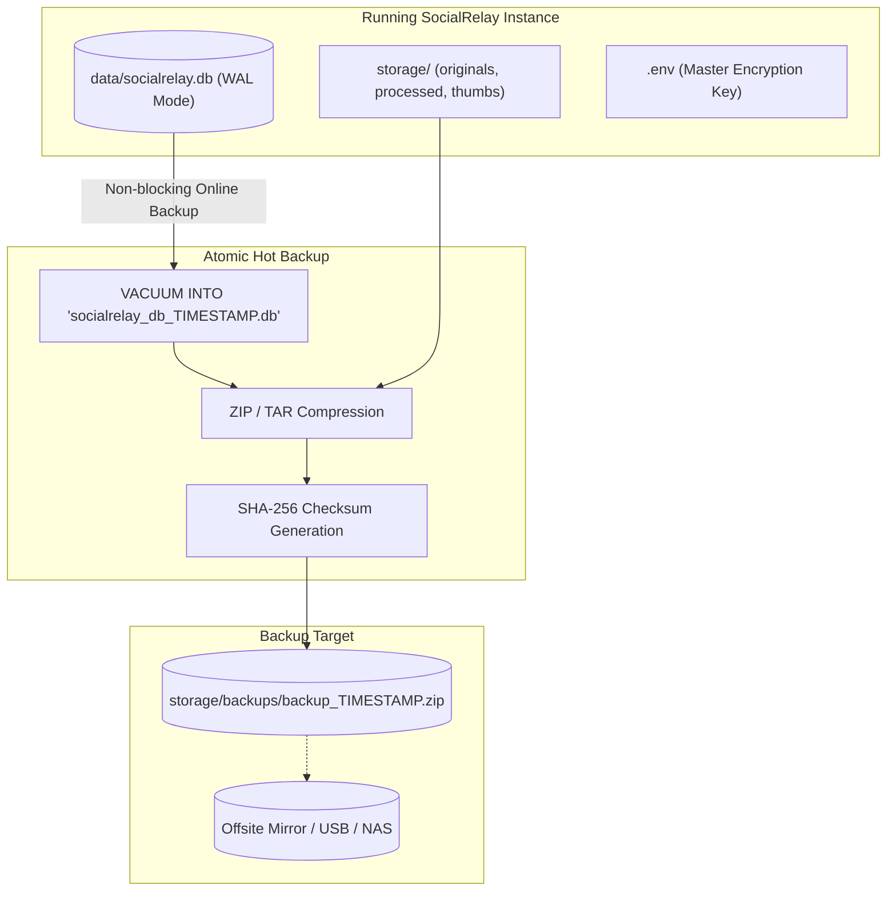

# SocialRelay v1.0.0 — Backup, Disaster Recovery & Restoration Guide

This runbook details procedures for hot online backups, cryptographic verification, automated scheduling, and disaster recovery for the SocialRelay cross-publishing platform.

---

## 1. Backup Architecture Overview

SocialRelay's state consists of two core components:
1. **Relational Database (`data/socialrelay.db`)**: Holds users, encrypted OAuth tokens, media metadata, drafts, schedules, and audit trails.
2. **Media Storage Directory (`storage/`)**: Holds imported originals (`storage/originals/`), 9:16 optimized masters (`storage/processed/`), thumbnails (`storage/thumbnails/`), and export archives.



---

## 2. Hot Online Database Backup

Because SQLite is running in **WAL mode (`PRAGMA journal_mode = WAL;`)**, standard file copies (`cp` or `copy`) while the database is active can capture an inconsistent transaction state. 

SocialRelay uses SQLite's native atomic **`VACUUM INTO`** command, which generates a fully defragmented, ACID-consistent single-file database snapshot without stopping the server or blocking concurrent readers/writers.

### Windows Native Backup
Run the bundled Windows backup script:
```powershell
.\infrastructure\scripts\backup.bat
```
Or execute directly via the Python runtime:
```powershell
.\.venv\Scripts\python.exe -c "import sqlite3; con = sqlite3.connect('data/socialrelay.db'); con.execute(\"VACUUM INTO 'storage/backups/db_backup.db'\"); con.close(); print('Backup complete!')"
```

### Linux / Docker Backup
Run the bundled shell script:
```bash
./infrastructure/scripts/backup.sh
```
Or via Docker:
```bash
docker compose exec socialrelay-api python -c "import sqlite3; con = sqlite3.connect('data/socialrelay.db'); con.execute(\"VACUUM INTO 'storage/backups/db_backup.db'\"); con.close()"
```

---

## 3. Full System Backup Script (Database + Media + Keys)

For total disaster readiness, create a single timestamped archive containing the database, media assets, and configuration.

### Bash Automation (`backup_full.sh`)
```bash
#!/usr/bin/env bash
set -e

TIMESTAMP=$(date +"%Y%m%d_%H%M%S")
BACKUP_DIR="storage/backups"
ARCHIVE_NAME="socialrelay_full_$TIMESTAMP.tar.gz"

mkdir -p "$BACKUP_DIR"

echo "Step 1: Creating atomic database snapshot..."
sqlite3 data/socialrelay.db "VACUUM INTO '$BACKUP_DIR/temp_db.db'"

echo "Step 2: Archiving database, storage, and config..."
tar -czf "$BACKUP_DIR/$ARCHIVE_NAME" \
    "$BACKUP_DIR/temp_db.db" \
    storage/originals \
    storage/processed \
    storage/thumbnails \
    .env

rm "$BACKUP_DIR/temp_db.db"

echo "Step 3: Calculating cryptographic checksum..."
sha256sum "$BACKUP_DIR/$ARCHIVE_NAME" > "$BACKUP_DIR/$ARCHIVE_NAME.sha256"

echo "Backup complete: $BACKUP_DIR/$ARCHIVE_NAME"
```

---

## 4. Disaster Recovery & Restoration Procedure

Follow this runbook to restore SocialRelay onto a brand-new machine following hardware failure or data corruption.

### Step 1: Install Dependencies
1. Clone the SocialRelay repository:
   ```bash
   git clone https://github.com/your-username/SocialRelay.git /opt/SocialRelay
   cd /opt/SocialRelay
   ```
2. Set up Python virtual environment and install dependencies:
   ```bash
   python3 -m venv .venv
   source .venv/bin/activate
   pip install -r requirements.txt
   ```

### Step 2: Unpack the Backup Archive
```bash
# Verify checksum before extraction
sha256sum -c storage/backups/socialrelay_full_20261126_120000.tar.gz.sha256

# Extract into project root
tar -xzf storage/backups/socialrelay_full_20261126_120000.tar.gz
```

### Step 3: Restore Database File
```bash
mkdir -p data
mv storage/backups/temp_db.db data/socialrelay.db
```

### Step 4: Verify Database Integrity
Run SQLite's built-in integrity checker:
```bash
python -c "import sqlite3; con = sqlite3.connect('data/socialrelay.db'); print(con.execute('PRAGMA integrity_check;').fetchall())"
```
**Expected Output**: `[('ok',)]`

### Step 5: Verify Master Encryption Secret
Ensure that the `.env` file contains the exact same `ENCRYPTION_SECRET_KEY` as the original installation.
> [!IMPORTANT]
> OAuth tokens in the `social_accounts` table are encrypted with Fernet AES-128. If the master key is lost, connected accounts will need to be reconnected via the UI.

### Step 6: Restart SocialRelay
```bash
# Windows
.\start.bat

# Linux / Docker
docker compose up -d --build
```
Log into `http://localhost:8000` and verify that all accounts, drafts, and media libraries are intact.

---

## 5. Automated Backup Scheduling via Cron / Task Scheduler

### Linux System Cron
Add an automated daily backup job at 02:00 AM (`crontab -e`):
```cron
0 2 * * * /opt/SocialRelay/infrastructure/scripts/backup.sh >> /var/log/socialrelay_backup.log 2>&1
```

### Free Offsite Mirroring with Rclone
To keep offsite copies on Google Drive or Proton Drive for free:
```bash
# Sync backups to cloud every night at 03:00 AM
0 3 * * * rclone sync /opt/SocialRelay/storage/backups gdrive:SocialRelayBackups --fast-list
```
