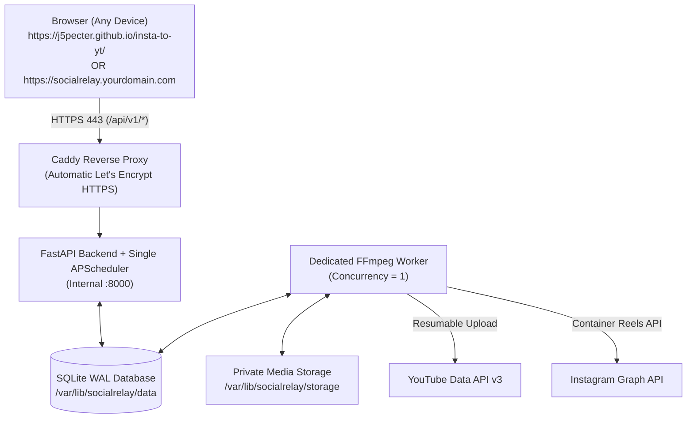

# SocialRelay V4 — Cloud Architecture

SocialRelay V4 separates static frontend distribution from private backend media processing and OAuth execution using zero-cost open-source infrastructure:

- **GitHub Pages (`https://j5pecter.github.io/insta-to-yt/`)**: Serves the compiled React SPA. Configurable at build time via `VITE_API_BASE_URL` (repository variable, never secrets).
- **Cloud Backend (`docker-compose.prod.yml`)**: Runs Caddy, Nginx (same-origin fallback SPA), FastAPI, and a dedicated ARM64/x86_64 FFmpeg worker sharing persistent host volumes at `/var/lib/socialrelay/`.
