# SocialRelay v1.0.0 — Database Schema Reference

SocialRelay utilizes **SQLite 3** with Write-Ahead Logging (`PRAGMA journal_mode = WAL;`) and strict Foreign Key enforcement (`PRAGMA foreign_keys = ON;`) for lightweight, ACID-compliant, self-hosted operational persistence. All models are defined in [entities.py](file:///d:/Claude%20Apps/Insta%20to%20YT/api/app/models/entities.py) using SQLAlchemy 2.0 Declarative ORM.

---

## 1. Entity-Relationship Diagram

```mermaid
erDiagram
    User ||--o{ SocialAccount : owns
    User ||--o{ SourceMedia : imports
    User ||--o{ ContentDraft : creates
    User ||--o{ PublishingIntent : schedules
    User ||--o{ AutomationWorkflow : configures
    User ||--o{ AuditLog : triggers

    SourceMedia ||--o{ MediaAsset : generates
    MediaAsset ||--o{ MediaRendition : produces
    MediaAsset ||--o{ ContentDraft : attaches_to

    ContentDraft ||--o{ PublishingIntent : targets
    PublishingIntent ||--o{ PublicationTarget : dispatches_to
    SocialAccount ||--o{ PublicationTarget : publishes_through
    PublicationTarget ||--o{ PublicationLog : records

    AutomationWorkflow ||--o{ AutomationNode : contains
    AutomationWorkflow ||--o{ AutomationEdge : connects
    AutomationWorkflow ||--o{ AutomationRun : executes

    User {
        int id PK
        string email UK
        string hashed_password
        string role
        boolean is_active
        datetime created_at
        datetime updated_at
    }

    SocialAccount {
        int id PK
        int user_id FK
        string platform
        string platform_user_id
        string account_name
        string encrypted_access_token
        string encrypted_refresh_token
        datetime token_expires_at
        string status
        datetime last_verified_at
        json extra_metadata
        datetime created_at
        datetime updated_at
    }

    SourceMedia {
        int id PK
        int user_id FK
        string source_type
        string original_url
        string platform_shortcode
        string author_name
        text original_caption
        int original_duration_sec
        string original_file_path
        string original_file_hash
        bigint file_size_bytes
        string mime_type
        datetime imported_at
        string status
    }

    MediaAsset {
        int id PK
        int source_media_id FK
        string file_path
        string file_hash UK
        string format
        int width
        int height
        float aspect_ratio
        float duration_sec
        bigint file_size_bytes
        string video_codec
        string audio_codec
        int bit_rate
        float frame_rate
        string thumbnail_path
        datetime created_at
    }

    MediaRendition {
        int id PK
        int media_asset_id FK
        string profile_name
        string file_path
        int width
        int height
        float aspect_ratio
        bigint file_size_bytes
        string status
        datetime created_at
    }

    ContentDraft {
        int id PK
        int user_id FK
        int media_asset_id FK
        string title
        text caption
        json hashtags
        string cover_image_path
        string youtube_title
        text youtube_description
        json youtube_tags
        string youtube_privacy
        boolean youtube_made_for_kids
        text instagram_caption
        string status
        datetime created_at
        datetime updated_at
    }

    PublishingIntent {
        int id PK
        int user_id FK
        int draft_id FK
        datetime scheduled_for
        string timezone
        string status
        string error_message
        int retry_count
        datetime created_at
        datetime updated_at
    }

    PublicationTarget {
        int id PK
        int intent_id FK
        int account_id FK
        string platform
        string platform_post_id
        string platform_post_url
        string status
        text error_message
        int retry_count
        string idempotency_key UK
        datetime published_at
        datetime created_at
        datetime updated_at
    }

    PublicationLog {
        int id PK
        int target_id FK
        string stage
        string status
        text message
        json raw_response
        datetime created_at
    }

    Job {
        int id PK
        string job_type
        string status
        json payload
        int retry_count
        int max_retries
        string locked_by
        datetime locked_at
        datetime run_after
        text error_message
        datetime created_at
        datetime updated_at
    }

    AutomationWorkflow {
        int id PK
        int user_id FK
        string name
        text description
        string trigger_type
        boolean is_active
        json canvas_data
        datetime created_at
        datetime updated_at
    }

    AutomationNode {
        int id PK
        int workflow_id FK
        string node_id
        string node_type
        string label
        json config
        float position_x
        float position_y
    }

    AutomationEdge {
        int id PK
        int workflow_id FK
        string edge_id
        string source_node_id
        string target_node_id
        string condition
    }

    AutomationRun {
        int id PK
        int workflow_id FK
        string trigger_event
        string status
        datetime started_at
        datetime finished_at
        json execution_log
        text error_message
    }

    AuditLog {
        int id PK
        int user_id FK
        string action
        string entity_type
        string entity_id
        string ip_address
        text user_agent
        json details
        datetime created_at
    }

    SystemSetting {
        int id PK
        string key UK
        string value
        string description
        datetime updated_at
    }
```



---

## 2. Table Specifications & Constraints

### 2.1 `users`
Stores system accounts for local authentication.
- **`id`** (`INTEGER`, PRIMARY KEY, AUTOINCREMENT)
- **`email`** (`VARCHAR(255)`, UNIQUE, NOT NULL, INDEXED)
- **`hashed_password`** (`VARCHAR(255)`, NOT NULL) — Argon2id salt & hash.
- **`role`** (`VARCHAR(50)`, DEFAULT `'admin'`) — `admin`, `operator`, `viewer`.
- **`is_active`** (`BOOLEAN`, DEFAULT `TRUE`)
- **`created_at`** (`DATETIME`, DEFAULT `utcnow`)
- **`updated_at`** (`DATETIME`, DEFAULT `utcnow`, onupdate)

### 2.2 `social_accounts`
Stores connected platform credentials and OAuth tokens encrypted at rest.
- **`id`** (`INTEGER`, PRIMARY KEY, AUTOINCREMENT)
- **`user_id`** (`INTEGER`, FOREIGN KEY -> `users.id` ON DELETE CASCADE, NOT NULL)
- **`platform`** (`VARCHAR(50)`, NOT NULL) — `'youtube'`, `'instagram'`, `'facebook'`.
- **`platform_user_id`** (`VARCHAR(255)`, NOT NULL) — Channel ID or Instagram Business User ID.
- **`account_name`** (`VARCHAR(255)`, NOT NULL)
- **`encrypted_access_token`** (`TEXT`, NOT NULL) — Fernet AES-128-CBC cipher text.
- **`encrypted_refresh_token`** (`TEXT`, NULLABLE) — Fernet AES-128-CBC cipher text.
- **`token_expires_at`** (`DATETIME`, NULLABLE)
- **`status`** (`VARCHAR(50)`, DEFAULT `'connected'`) — `'connected'`, `'expired'`, `'revoked'`, `'error'`.
- **`last_verified_at`** (`DATETIME`, NULLABLE)
- **`extra_metadata`** (`JSON`, NULLABLE) — Channel thumbnails, subscriber count, permissions.
- **`created_at`** / **`updated_at`** (`DATETIME`)

### 2.3 `source_media`
Tracks original incoming media files before normalization.
- **`id`** (`INTEGER`, PRIMARY KEY, AUTOINCREMENT)
- **`user_id`** (`INTEGER`, FOREIGN KEY -> `users.id` ON DELETE SET NULL, NULLABLE)
- **`source_type`** (`VARCHAR(50)`, NOT NULL) — `'instagram_url'`, `'local_upload'`, `'bulk_csv'`.
- **`original_url`** (`TEXT`, NULLABLE)
- **`platform_shortcode`** (`VARCHAR(100)`, NULLABLE, INDEXED)
- **`author_name`** (`VARCHAR(255)`, NULLABLE)
- **`original_caption`** (`TEXT`, NULLABLE)
- **`original_duration_sec`** (`INTEGER`, NULLABLE)
- **`original_file_path`** (`TEXT`, NOT NULL)
- **`original_file_hash`** (`VARCHAR(64)`, NOT NULL, INDEXED) — SHA-256 of raw file.
- **`file_size_bytes`** (`BIGINT`, NOT NULL)
- **`mime_type`** (`VARCHAR(100)`, NOT NULL)
- **`imported_at`** (`DATETIME`, DEFAULT `utcnow`)
- **`status`** (`VARCHAR(50)`, DEFAULT `'imported'`)

### 2.4 `media_assets`
Represents processed, standardized, platform-compliant vertical master video assets (1080×1920 H.264).
- **`id`** (`INTEGER`, PRIMARY KEY, AUTOINCREMENT)
- **`source_media_id`** (`INTEGER`, FOREIGN KEY -> `source_media.id` ON DELETE SET NULL, NULLABLE)
- **`file_path`** (`TEXT`, NOT NULL)
- **`file_hash`** (`VARCHAR(64)`, UNIQUE, NOT NULL, INDEXED)
- **`format`** (`VARCHAR(20)`, DEFAULT `'mp4'`)
- **`width`** (`INTEGER`, NOT NULL) — 1080
- **`height`** (`INTEGER`, NOT NULL) — 1920
- **`aspect_ratio`** (`FLOAT`, NOT NULL) — 0.5625 (9:16)
- **`duration_sec`** (`FLOAT`, NOT NULL)
- **`file_size_bytes`** (`BIGINT`, NOT NULL)
- **`video_codec`** (`VARCHAR(50)`, DEFAULT `'h264'`)
- **`audio_codec`** (`VARCHAR(50)`, DEFAULT `'aac'`)
- **`bit_rate`** (`INTEGER`, NULLABLE)
- **`frame_rate`** (`FLOAT`, DEFAULT `30.0`)
- **`thumbnail_path`** (`TEXT`, NULLABLE)
- **`created_at`** (`DATETIME`, DEFAULT `utcnow`)

### 2.5 `media_renditions`
Contains alternate formats or resolution adaptations of a master asset.
- **`id`** (`INTEGER`, PRIMARY KEY, AUTOINCREMENT)
- **`media_asset_id`** (`INTEGER`, FOREIGN KEY -> `media_assets.id` ON DELETE CASCADE, NOT NULL)
- **`profile_name`** (`VARCHAR(100)`, NOT NULL) — `'instagram_reel'`, `'youtube_short'`, `'square_feed'`.
- **`file_path`** (`TEXT`, NOT NULL)
- **`width`** / **`height`** (`INTEGER`, NOT NULL)
- **`aspect_ratio`** (`FLOAT`, NOT NULL)
- **`file_size_bytes`** (`BIGINT`, NOT NULL)
- **`status`** (`VARCHAR(50)`, DEFAULT `'ready'`)
- **`created_at`** (`DATETIME`, DEFAULT `utcnow`)

### 2.6 `content_drafts`
Workspace item combining media, titles, captions, hashtags, and platform metadata.
- **`id`** (`INTEGER`, PRIMARY KEY, AUTOINCREMENT)
- **`user_id`** (`INTEGER`, FOREIGN KEY -> `users.id` ON DELETE SET NULL, NULLABLE)
- **`media_asset_id`** (`INTEGER`, FOREIGN KEY -> `media_assets.id` ON DELETE RESTRICT, NOT NULL)
- **`title`** (`VARCHAR(255)`, NOT NULL)
- **`caption`** (`TEXT`, NULLABLE)
- **`hashtags`** (`JSON`, DEFAULT `'[]'`)
- **`cover_image_path`** (`TEXT`, NULLABLE)
- **`youtube_title`** (`VARCHAR(100)`, NULLABLE) — Enforces YouTube 100 character maximum limit.
- **`youtube_description`** (`TEXT`, NULLABLE) — Enforces YouTube 5,000 byte maximum limit.
- **`youtube_tags`** (`JSON`, DEFAULT `'[]'`)
- **`youtube_privacy`** (`VARCHAR(50)`, DEFAULT `'public'`) — `'public'`, `'unlisted'`, `'private'`.
- **`youtube_made_for_kids`** (`BOOLEAN`, DEFAULT `FALSE`)
- **`instagram_caption`** (`TEXT`, NULLABLE) — Enforces Instagram 2,200 character limit and max 30 hashtags.
- **`status`** (`VARCHAR(50)`, DEFAULT `'draft'`) — `'draft'`, `'scheduled'`, `'published'`, `'archived'`.
- **`created_at`** / **`updated_at`** (`DATETIME`)

### 2.7 `publishing_intents`
High-level schedule or immediate publish request representing an intent to broadcast a draft.
- **`id`** (`INTEGER`, PRIMARY KEY, AUTOINCREMENT)
- **`user_id`** (`INTEGER`, FOREIGN KEY -> `users.id` ON DELETE SET NULL, NULLABLE)
- **`draft_id`** (`INTEGER`, FOREIGN KEY -> `content_drafts.id` ON DELETE CASCADE, NOT NULL)
- **`scheduled_for`** (`DATETIME`, NULLABLE, INDEXED) — `None` indicates immediate execution.
- **`timezone`** (`VARCHAR(100)`, DEFAULT `'Asia/Kolkata'`)
- **`status`** (`VARCHAR(50)`, DEFAULT `'pending'`) — `pending`, `processing`, `completed`, `partial_failure`, `failed`, `cancelled`.
- **`error_message`** (`TEXT`, NULLABLE)
- **`retry_count`** (`INTEGER`, DEFAULT `0`)
- **`created_at`** / **`updated_at`** (`DATETIME`)

### 2.8 `publication_targets`
Granular per-platform dispatch target with deterministic idempotency tracking.
- **`id`** (`INTEGER`, PRIMARY KEY, AUTOINCREMENT)
- **`intent_id`** (`INTEGER`, FOREIGN KEY -> `publishing_intents.id` ON DELETE CASCADE, NOT NULL)
- **`account_id`** (`INTEGER`, FOREIGN KEY -> `social_accounts.id` ON DELETE RESTRICT, NOT NULL)
- **`platform`** (`VARCHAR(50)`, NOT NULL)
- **`platform_post_id`** (`VARCHAR(255)`, NULLABLE) — YouTube Video ID or Instagram Media ID.
- **`platform_post_url`** (`TEXT`, NULLABLE)
- **`status`** (`VARCHAR(50)`, DEFAULT `'queued'`) — `queued`, `publishing`, `published`, `failed`.
- **`error_message`** (`TEXT`, NULLABLE)
- **`retry_count`** (`INTEGER`, DEFAULT `0`)
- **`idempotency_key`** (`VARCHAR(255)`, UNIQUE, NOT NULL, INDEXED) — `hash(draft_id + account_id + scheduled_time)`.
- **`published_at`** (`DATETIME`, NULLABLE)
- **`created_at`** / **`updated_at`** (`DATETIME`)

### 2.9 `publication_logs`
Fine-grained execution telemetry trace for each publication target step.
- **`id`** (`INTEGER`, PRIMARY KEY, AUTOINCREMENT)
- **`target_id`** (`INTEGER`, FOREIGN KEY -> `publication_targets.id` ON DELETE CASCADE, NOT NULL)
- **`stage`** (`VARCHAR(100)`, NOT NULL) — e.g., `'token_check'`, `'container_created'`, `'video_uploaded'`.
- **`status`** (`VARCHAR(50)`, NOT NULL) — `'info'`, `'success'`, `'error'`.
- **`message`** (`TEXT`, NOT NULL)
- **`raw_response`** (`JSON`, NULLABLE)
- **`created_at`** (`DATETIME`, DEFAULT `utcnow`, INDEXED)

### 2.10 `jobs`
Persistent SQLite transactional job queue for all asynchronous tasks.
- **`id`** (`INTEGER`, PRIMARY KEY, AUTOINCREMENT)
- **`job_type`** (`VARCHAR(100)`, NOT NULL, INDEXED) — `'import_media'`, `'optimize_video'`, `'publish_post'`, `'system_cleanup'`.
- **`status`** (`VARCHAR(50)`, DEFAULT `'queued'`, INDEXED) — `'queued'`, `'leased'`, `'running'`, `'completed'`, `'failed'`, `'dead_letter'`.
- **`payload`** (`JSON`, NOT NULL)
- **`retry_count`** (`INTEGER`, DEFAULT `0`)
- **`max_retries`** (`INTEGER`, DEFAULT `3`)
- **`locked_by`** (`VARCHAR(100)`, NULLABLE) — Worker ID lease identifier.
- **`locked_at`** (`DATETIME`, NULLABLE)
- **`run_after`** (`DATETIME`, DEFAULT `utcnow`, INDEXED)
- **`error_message`** (`TEXT`, NULLABLE)
- **`created_at`** / **`updated_at`** (`DATETIME`)

---

## 3. Database Indexes

| Table | Index Name | Columns | Purpose |
|---|---|---|---|
| `users` | `ix_users_email` | `email` (UNIQUE) | Fast authentication lookup |
| `source_media` | `ix_source_media_hash` | `original_file_hash` | Fast duplicate import detection |
| `source_media` | `ix_source_media_shortcode` | `platform_shortcode` | Querying by Instagram shortcode |
| `media_assets` | `ix_media_assets_hash` | `file_hash` (UNIQUE) | Master video deduplication |
| `publishing_intents` | `ix_intents_scheduled_for` | `scheduled_for`, `status` | High-frequency scheduler polling |
| `publication_targets` | `ix_targets_idempotency` | `idempotency_key` (UNIQUE) | Absolute prevention of duplicate platform posts |
| `jobs` | `ix_jobs_poll` | `status`, `run_after`, `retry_count` | Atomic worker lease queries (`SELECT FOR UPDATE` emulation) |
| `publication_logs` | `ix_pub_logs_target` | `target_id`, `created_at` | Audit timeline reconstruction |

---

## 4. SQLite Optimization & PRAGMA Settings

SocialRelay initializes its SQLite engine with performance and safety PRAGMAs configured in [database.py](file:///d:/Claude%20Apps/Insta%20to%20YT/api/app/core/database.py):

```python
@event.listens_for(engine, "connect")
def set_sqlite_pragma(dbapi_connection, connection_record):
    cursor = dbapi_connection.cursor()
    cursor.execute("PRAGMA foreign_keys = ON;")
    cursor.execute("PRAGMA journal_mode = WAL;")
    cursor.execute("PRAGMA synchronous = NORMAL;")
    cursor.execute("PRAGMA busy_timeout = 5000;")
    cursor.close()
```

- **`journal_mode = WAL`**: Write-Ahead Logging allows simultaneous concurrent readers while a writer commits. Readers never block writers, and writers never block readers.
- **`foreign_keys = ON`**: Enforces relational integrity across parent/child tables (deletions cascade correctly).
- **`synchronous = NORMAL`**: Eliminates redundant disk sync operations without compromising database integrity in WAL mode.
- **`busy_timeout = 5000`**: SQLite will wait up to 5,000ms before returning a `SQLITE_BUSY` error during concurrent writes.

---

## 5. SQLite to PostgreSQL Migration Roadmap

If scaling beyond single-host self-hosting, the schema translates directly to PostgreSQL with the following adaptations:

| SQLite Feature | PostgreSQL Native Equivalent | Migration Note |
|---|---|---|
| `INTEGER PRIMARY KEY AUTOINCREMENT` | `BIGSERIAL PRIMARY KEY` or `GENERATED ALWAYS AS IDENTITY` | PostgreSQL sequences provide atomic IDs |
| `JSON` (stored as TEXT in SQLite) | `JSONB` | Enables binary GIN indexing (`CREATE INDEX ON ... USING GIN(payload)`) |
| `DATETIME` | `TIMESTAMP WITH TIME ZONE` | Explicit UTC storage |
| `PRAGMA busy_timeout` | Connection Pool (`NullPool` / `QueuePool`) | Native row-level locking via `SELECT ... FOR UPDATE SKIP LOCKED` |
| SQLite WAL File | PostgreSQL WAL & MVCC | Native multi-master and replica support |

Alembic migration scripts can be generated automatically:
```bash
alembic revision --autogenerate -m "Initial schema"
alembic upgrade head
```
