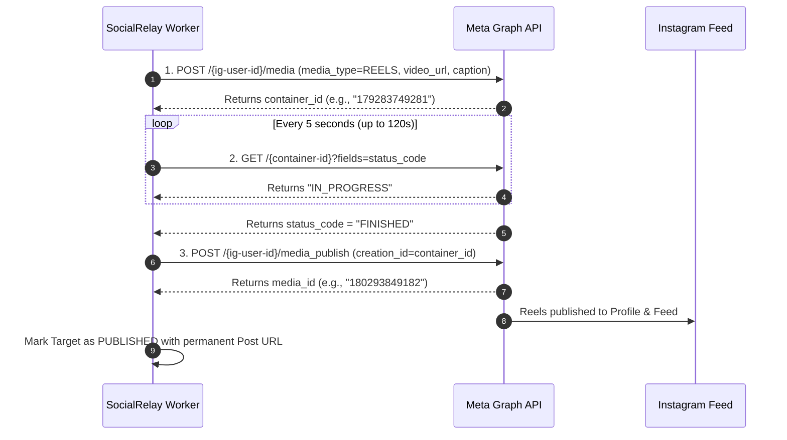

# SocialRelay v1.0.0 — Instagram Graph API Setup Guide

This guide details the step-by-step process for configuring official Meta Graph API access to publish Instagram Reels automatically from SocialRelay without third-party aggregator subscriptions.

---

## 1. Prerequisites

1. **Instagram Professional Account**:
   - Must be configured as either a **Creator** or **Business** account (personal Instagram accounts do not support API publishing).
   - In Instagram app: Go to **Settings > Account type and tools > Switch to professional account**.
2. **Linked Facebook Page**:
   - Meta requires all Instagram Professional accounts to be associated with a Facebook Page to grant publishing tokens.
   - Go to **Instagram Profile > Edit profile > Page** and connect your Facebook Page.
3. **Meta for Developers Account**:
   - Register for free at [developers.facebook.com](https://developers.facebook.com/).

---

## 2. Meta App Creation

1. Navigate to the [Meta Developer Dashboard](https://developers.facebook.com/apps/) and click **Create App**.
2. Select **Other** as the use case and click **Next**.
3. Select **Business** as the app type.
4. Enter an **App name** (e.g., `SocialRelay Publisher`) and your contact email.
5. In the App Dashboard under **Add products to your app**:
   - Locate **Instagram Graph API** and click **Set Up**.
   - Locate **Facebook Login for Business** and click **Set Up**.

---

## 3. Configure OAuth & Permissions

### 3.1 Configure Redirect URI
1. In the left navigation, open **Facebook Login for Business > Settings**.
2. Under **Valid OAuth Redirect URIs**, enter:
   ```
   http://localhost:8000/api/v1/accounts/instagram/callback
   ```
   *(If deploying with a domain or tunnel, add `https://relay.yourdomain.com/api/v1/accounts/instagram/callback`)*
3. Save changes.

### 3.2 Required Scopes
SocialRelay requests the following standard scopes during authentication:
- `instagram_basic`: Read basic account information and Instagram User ID.
- `instagram_content_publish`: Upload and publish Reels and Carousel media.
- `pages_show_list`: Discover the Facebook Page linked to your Instagram account.
- `pages_read_engagement`: Monitor post metrics and publication status.

---

## 4. Obtain App Credentials & Configure SocialRelay

1. Go to **App Settings > Basic** in the Meta Developer Console.
2. Note your **App ID** and **App Secret**.
3. Open your SocialRelay `.env` file and set:
   ```env
   INSTAGRAM_APP_ID=your_meta_app_id
   INSTAGRAM_APP_SECRET=your_meta_app_secret
   INSTAGRAM_REDIRECT_URI=http://localhost:8000/api/v1/accounts/instagram/callback
   ```

---

## 5. How Instagram Automated Reels Publishing Works

Meta uses an asynchronous **Container Publishing Workflow**:



### Video URL Requirement for Meta API
Meta servers require a publicly reachable HTTP/HTTPS URL to download your video into their transcode containers.
- When running SocialRelay on a home PC, use a free tunnel like **Cloudflare Tunnel** (`cloudflared tunnel`) or **Tailscale Funnel** to expose the `storage/processed` folder.
- Set `PUBLIC_STORAGE_BASE_URL=https://relay-public.yourdomain.com/storage/processed` in `.env`.

---

## 6. Zero-Friction Fallback: Manual Export ZIP Package

If you do not want to configure public tunnels or Meta App Developer verification, SocialRelay includes an integrated **Manual Export Package**:
1. In the Content Studio or Queue, click **Export Manual Package**.
2. SocialRelay instantly generates a single downloadable `.zip` containing:
   - `video_1080x1920.mp4` (Optimized H.264 9:16 vertical video)
   - `cover_frame.jpg` (Thumbnail extracted from chosen timestamp)
   - `metadata.txt` (Pre-formatted title, caption, hashtags, and upload instructions)
3. Transfer the file to your mobile phone via AirDrop, Quick Share, or Telegram Saved Messages and post in seconds directly from the native Instagram app.
