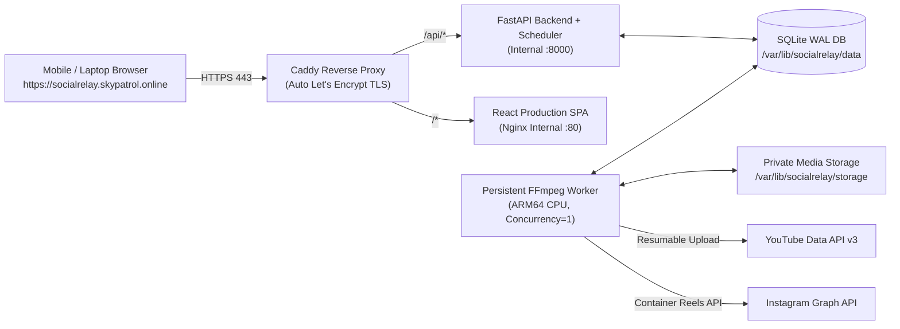

# SocialRelay V3 — Oracle Cloud Always Free Production Deployment Guide

This guide walks through deploying **SocialRelay** as a 24/7, internet-accessible HTTPS web application at `https://socialrelay.skypatrol.online` on **Oracle Cloud Infrastructure (OCI) Always Free** (Ubuntu 24.04 ARM64 Ampere A1), with zero mandatory software subscriptions.

---

## 1. Architecture Overview



- **Only ports `80` and `443` are exposed publicly** (via Caddy).
- FastAPI (`:8000`), Nginx (`:80`), SQLite, and media files are isolated on an internal Docker bridge network and `/var/lib/socialrelay/`.
- Your existing `skypatrol.online` root domain remains completely untouched—only the `socialrelay` subdomain `A` record is added.

---

## 2. Step 1 — Create Oracle Cloud Always Free Account

1. Visit [Oracle Cloud Free Tier](https://www.oracle.com/in/cloud/free/).
2. Complete account registration, email/identity verification, and payment-card verification (no charges are incurred when provisioning **Always Free** eligible shapes).
3. Select your **Home Region** carefully—Always Free Ampere A1 instances can only be created in your home region.

---

## 3. Step 2 — Create the ARM64 Compute Instance

In the OCI Console, go to **Compute → Instances → Create Instance**:

| Setting | Value |
|---|---|
| **Name** | `socialrelay-production` |
| **Image** | Ubuntu 24.04 LTS (Canonical, ARM64 / `aarch64`) |
| **Shape** | `VM.Standard.A1.Flex` (**Always Free Eligible**) |
| **OCPUs** | `2` |
| **Memory (RAM)** | `12 GB` |
| **Boot Volume** | `50 GB` (within 200 GB Always Free allowance) |
| **Public IPv4** | Assign a public IPv4 address |
| **SSH Keys** | Generate and download private `.key` (never commit to GitHub) |

> [!NOTE]
> If OCI reports *"Out of capacity for shape VM.Standard.A1.Flex"*, try another Availability Domain (AD-1, AD-2, AD-3) or retry during off-peak hours.

---

## 4. Step 3 — Configure Oracle Networking & Ubuntu Firewall

### 4.1 OCI Virtual Cloud Network (VCN) Security List
In OCI Console → **Networking → Virtual Cloud Networks → Security Lists → Default Security List**, add Ingress Rules:

| Source CIDR | Protocol | Destination Port | Purpose |
|---|---|---|---|
| `YOUR_HOME_IP/32` | TCP | `22` | SSH administration (restricted) |
| `0.0.0.0/0` | TCP | `80` | HTTP + Let's Encrypt ACME validation |
| `0.0.0.0/0` | TCP | `443` | Public HTTPS website |

*Do NOT open port `8000`, `5432`, or `11434` in OCI Security Lists.*

### 4.2 Ubuntu Firewall (`ufw` / `iptables`)
SSH into your instance (`ssh -i your-key.key ubuntu@<PUBLIC_IP>`):
```bash
sudo ufw allow OpenSSH
sudo ufw allow 80/tcp
sudo ufw allow 443/tcp
sudo ufw --force enable
sudo ufw status
```
*(Note: On Oracle Ubuntu images, if `iptables-persistent` blocks traffic, open ports 80 and 443 in `/etc/iptables/rules.v4` or run `sudo netfilter-persistent flush` after configuring `ufw`.)*

---

## 5. Step 4 — Configure Subdomain DNS (`socialrelay.skypatrol.online`)

In your domain registrar / DNS provider for `skypatrol.online`, add **only** this single record:

| Type | Name / Host | Value / IPv4 | TTL |
|---|---|---|---|
| `A` | `socialrelay` | `<YOUR_ORACLE_PUBLIC_IP>` | `300` (or Auto) |

Verify DNS propagation:
```bash
dig +short socialrelay.skypatrol.online
```

---

## 6. Step 5 — Install & Deploy SocialRelay on the Server

On your Oracle Ubuntu server:

```bash
# 1. Clone the public repository
git clone https://github.com/J5pecter/insta-to-yt.git /opt/socialrelay
cd /opt/socialrelay

# 2. Run production installer (installs Docker, creates /var/lib/socialrelay, generates secrets)
chmod +x scripts/*.sh
./scripts/install-production.sh

# 3. Set your strong administrator email & password (min 12 chars)
./scripts/setup-admin.sh

# 4. Build and launch Caddy + React Web + FastAPI + Worker
./scripts/deploy-production.sh
```

---

## 7. Step 6 — Verify HTTPS & Connectivity

1. Open `https://socialrelay.skypatrol.online` from your mobile phone or laptop (with your home PC turned off).
2. Confirm the padlock icon (valid Let's Encrypt TLS certificate issued automatically by Caddy).
3. Sign in with the administrator email and password you configured in `setup-admin.sh`.
4. Confirm the top header shows **Server online**.

---

## 8. Step 7 — Migrate YouTube & Instagram OAuth to Production

Your OAuth redirect URIs must now point to your HTTPS domain:

- **YouTube Authorized Redirect URI** (Google Cloud Console → Credentials):
  ```
  https://socialrelay.skypatrol.online/api/v1/accounts/youtube/callback
  ```
- **Instagram OAuth Redirect URI** (Meta for Developers → Instagram API with Instagram Login):
  ```
  https://socialrelay.skypatrol.online/api/v1/accounts/instagram/callback
  ```

In SocialRelay (`https://socialrelay.skypatrol.online`):
1. Open **Accounts → YouTube Setup Wizard**, copy the callback URL, upload `client_secret.json`, and click **Connect YouTube**.
2. Open **Accounts → Instagram Setup Wizard**, copy the callback URL, save your App ID & Secret, and click **Connect Instagram**.
3. Test your first authorized video as **Private** before switching your default preset to **Public**.

---

## 9. Maintenance, Backups & Updates

| Task | Command |
|---|---|
| **Check service health** | `./scripts/health-check.sh` |
| **Create atomic DB backup** | `./scripts/backup-production.sh` |
| **Restore DB from backup** | `./scripts/restore-production.sh /var/lib/socialrelay/storage/backups/<file>.db` |
| **Update to latest release** | `./scripts/update-production.sh` (auto-backs up & rolls back on failure) |
| **Security & hygiene audit** | `./scripts/security-audit.sh` |

### Automated Daily Cron Backup
```bash
crontab -e
# Add daily 02:00 AM atomic SQLite backup:
0 2 * * * /opt/socialrelay/scripts/backup-production.sh >> /var/log/socialrelay-backup.log 2>&1
```

---

## 10. Troubleshooting

| Issue | Cause & Fix |
|---|---|
| **Out of capacity in OCI** | Switch Availability Domain (`AD-1`/`AD-2`/`AD-3`) during creation, or start with 1 OCPU / 6 GB RAM. |
| **Caddy HTTPS certificate fails** | Ensure DNS `A` record points to the exact OCI public IP and ports `80` + `443` are open in both OCI Security List and `iptables`/`ufw`. |
| **502 Bad Gateway from Caddy** | Run `docker compose -f docker-compose.prod.yml logs api` to inspect FastAPI startup; check `.env.production` for missing secrets. |
| **OAuth `redirect_uri_mismatch`** | Copy the exact HTTPS callback URL shown in SocialRelay's **Account Setup Wizard** into Google Cloud Console / Meta Developer Console. |
| **ARM64 Docker build error** | `docker-compose.prod.yml` uses multi-arch `python:3.11-slim`, `node:20-alpine`, `nginx:alpine`, and `caddy:2-alpine` images natively supporting `linux/arm64`. |
