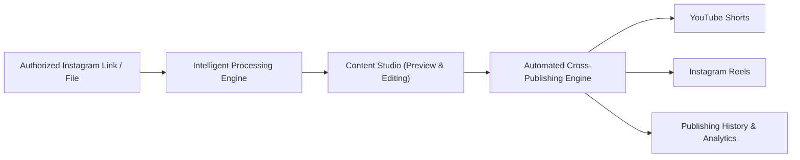

# Product Requirements Document (PRD) — SocialRelay

**Project Name**: SocialRelay  
**Version**: 1.0.0  
**Status**: Ready for Production  
**Owner**: Self-Hosted Creator & Platform Team  

---

## 1. Executive Summary & Product Vision

**SocialRelay** is a personal, self-hosted social media automation and cross-publishing platform designed to eliminate recurring SaaS subscription costs (e.g. Buffer, Metricool, Hootsuite, Make.com, Zapier).

The system allows an administrator to import creator-authorized Instagram Reels or upload local video files, automatically optimize them into vertical 9:16 (1080×1920) formats, extract and prepare platform-tailored metadata (YouTube Shorts & Instagram Reels), and distribute them across connected accounts using a persistent scheduler, robust state machine, and visual automation DAG workflow builder.

---

## 2. Core Business Objectives

1. **Zero Mandatory Subscriptions**: The core platform runs 100% on open-source, local, and free-tier components.
2. **Authorized Media Only**: Protect creators by handling only owned, licensed, or explicitly creator-authorized media.
3. **Robust Automation**: Schedule and auto-publish content with atomic leases, automatic worker crash recovery, and duplication prevention.
4. **Complete Multi-Channel Distribution**: Support YouTube Data API v3 and Meta Graph API with platform-specific validation.
5. **Full Operational Dashboard**: Provide 31 fully functioning screens covering all aspects of content operations.

---

## 3. User Personas & Use Cases

### Primary Persona: Independent Content Creator / Media Manager
- **Goal**: Cross-post vertical short-form videos to YouTube Shorts and Instagram Reels without logging into each app or paying $30–$80/month for social schedulers.
- **Pain Points**:
  - Monthly subscription creep.
  - Manual copy-pasting of titles, descriptions, and hashtags.
  - Video format incompatibilities (horizontal videos rejected or cropped poorly).
  - Quota exhaustion on cloud APIs.

---

## 4. Functional Requirements

### 4.1. Media Ingestion & Import Module
- **URL Import**: Accept Instagram Reel and video URLs (`/reel/<id>/`, `/p/<id>/`). Strip tracking queries (`?igsh=...`, `?utm_source=...`).
- **File Upload**: Direct drag-and-drop of MP4 and QuickTime MOV files up to 500 MB. Validate file signature magic bytes (`ftyp`).
- **Bulk CSV / Links**: Import batch links from multiline text or CSV files.
- **Duplicate Prevention**: SHA-256 fingerprinting prevents re-importing identical video files.
- **SSRF Guard**: Block requests targeting RFC 1918 private IPs, loopback, or cloud metadata services.

### 4.2. Video Processing Pipeline (FFmpeg 7.1)
- **Probing**: Extract duration, resolution, aspect ratio, frame rate, audio/video codecs, bitrate, and rotation.
- **Vertical Optimization (1080×1920)**:
  - If source is 9:16 vertical: Scale cleanly preserving aspect ratio.
  - If source is horizontal/square: Fit with blurred background or center-crop.
- **Trimming & Muting**: Frame-accurate seeking, trimming, and audio muting.
- **Thumbnails**: High-resolution cover frame extraction at arbitrary timestamps and multi-frame contact sheets.

### 4.3. Metadata Engine & Caption-to-Title Conversion
- **Separate Platform Fields**: Maintain original caption, YouTube title, YouTube description, YouTube tags, Instagram caption, Instagram hashtags, and creator attribution.
- **Modes of Operation**:
  - *Mode A: Exact Copy*: Verbatim preservation.
  - *Mode B: Caption Cleanup*: Strip hashtags and URLs from title.
  - *Mode C: First Sentence*: Extract first clean sentence.
  - *Mode D: Local AI*: Optional local Ollama (`qwen2.5:7b` / `gemma`) with deterministic fallback.
- **Strict YouTube Constraints**: Title ≤ 100 characters; description ≤ 5,000 UTF-8 bytes.
- **Instagram Constraints**: Caption ≤ 2,200 characters; maximum 30 hashtags.

### 4.4. Social Account Management & OAuth
- **YouTube Data API v3**: Official Google OAuth 2.0 with PKCE and offline token refresh.
- **Meta Graph API**: Official Instagram Login for Business/Creator accounts with long-lived tokens.
- **Token Security**: Tokens encrypted at rest using AES-GCM / Fernet. Master encryption key loaded from environment.

### 4.5. Publishing Engine & Job State Machine
- **State Flow**: Explicit 20-state machine (`CREATED` → `VALIDATING` → `IMPORTING` → `PROCESSING` → `APPROVED` → `QUEUED` → `UPLOADING` → `PUBLISHED`).
- **Idempotency**: Unique publishing key `(asset_id, account_id, intent_id)` prevents duplicate uploads.
- **Resilient Queue**: Bounded exponential backoff with jitter (max 5 retries).
- **Reconciliation**: Flag ambiguous timeouts as `RECONCILIATION_REQUIRED` to avoid blind re-uploads.

### 4.6. Visual Automation DAG Builder
- **Triggers**: URL submitted, file uploaded, scheduled time reached, approved draft created, manual execution.
- **Conditions**: Video orientation, duration limits, caption presence, rights confirmation, account availability.
- **Actions**: Optimize video, generate title, create draft, publish YouTube, publish Instagram, notify admin.
- **DAG Validation**: Kahn's topological sort ensures cycle-free execution. Dry-run simulation mode.
- **Pre-Built Templates**: 6 production templates included out of the box.

### 4.7. Content Calendar
- **Interactive Views**: Month, week, and day calendar views.
- **Rescheduling**: Visual scheduling with local timezone support (`Asia/Kolkata`).

### 4.8. Storage Management & Backup
- **Storage Partitions**: Organized by UUID into `originals/`, `processed/`, `thumbnails/`, `temporary/`, `backups/`.
- **Retention**: Clean temporary files older than 24 hours.
- **Atomic Backup**: SQLite `VACUUM INTO` creates non-blocking snapshot packaged into verified SHA-256 ZIP bundles.

---

## 5. Non-Functional Requirements

| Metric | Target Requirement |
|---|---|
| **Software Cost** | ₹0 / $0 mandatory monthly software subscriptions |
| **Response Time** | API endpoints respond in < 150 ms (excluding long-running uploads) |
| **Worker Concurrency** | Configurable worker threads (default 2 concurrent jobs) |
| **Data Retention** | Permanent local history in SQLite with WAL mode |
| **Security Standards** | Argon2id password hashing, AES token encryption, strict SSRF validation |
| **Accessibility** | WCAG 2.1 AA compliant UI, 44px touch targets, dark/light theme |

---

## 6. Success Metrics & Acceptance Criteria

1. Administrator can paste an Instagram Reel URL, preview the vertical video, adjust title, and publish to YouTube Shorts in under 60 seconds.
2. In the event of network disruption, the job queue recovers without creating duplicate posts.
3. System survives restarts and automatically resumes scheduled jobs.
4. Automated tests achieve 100% pass rate across core workflows.
