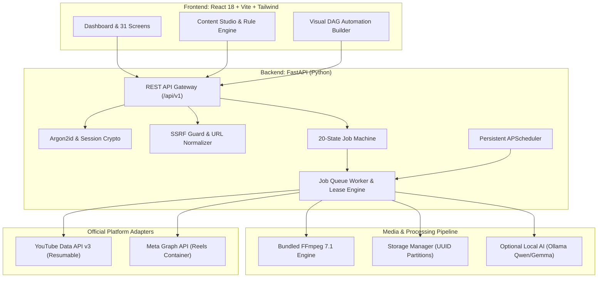

# SocialRelay — Self-Hosted Social Media Automation Platform

[](LICENSE)
[](https://www.python.org/)
[](https://fastapi.tiangolo.com/)
[](https://react.dev/)
[](https://tailwindcss.com/)
[](TEST-REPORT.md)

**SocialRelay** is a production-oriented, personal, self-hosted social media automation and cross-publishing platform. Import creator-authorized Instagram Reels or videos, automatically optimize them into vertical 9:16 (1080×1920) H.264 formats, generate platform-compliant metadata (YouTube Shorts & Instagram Reels), and distribute them across connected accounts using a persistent scheduler, robust state machine, and visual automation DAG workflow builder — **with zero mandatory monthly subscriptions**.

Think of it as your private, self-hosted replacement for Buffer, Metricool, Hootsuite, and Zapier running entirely on your own hardware.

---

## Architecture Overview



---

## Key Features

- **Creator-Authorized Media Imports**: Import Reels via canonical URL or upload authorized MP4/MOV files with binary magic-byte validation and SHA-256 deduplication.
- **Automated Video Optimization**: Converts horizontal or irregular videos into 1080×1920 9:16 vertical video using fit-with-blur background, center-crop, or fast-seek trimming.
- **Platform Metadata Engine**: Converts Instagram captions into YouTube titles (strict ≤100 characters), validates description byte limits (≤5,000 bytes), extracts hashtags, and runs local AI (Ollama) or deterministic rule fallbacks.
- **Official OAuth & Token Encryption**: Encrypts YouTube and Instagram access/refresh tokens at rest using AES-GCM / Fernet with master keys kept outside the database.
- **Resilient 20-State Job Machine**: Atomic leases, heartbeat tracking, exponential backoff with jitter, worker crash recovery, and reconciliation of ambiguous states.
- **Visual Automation Builder**: Drag-and-drop DAG workflow builder with cycle detection and 6 pre-built production automation templates.
- **Content Calendar**: Interactive day, week, and month scheduling calendar with rescheduling and drag-and-drop support.
- **Privacy & Security**: Argon2id password hashing, strict SSRF blocking (RFC1918, localhost, AWS/GCP metadata), safe argument-array subprocesses, and atomic VACUUM INTO database backups.

---

## Quick Start (Under 3 Minutes)

### 1. Direct Local Start (Windows)
Double-click **`start.bat`** in the project directory.
The script will automatically initialize the environment, start the background worker and scheduler, and launch the web dashboard at:
👉 **[http://localhost:8000](http://localhost:8000)**

- **Default Administrator Email**: `admin@socialrelay.local`
- **Default Password**: `admin1234` *(change immediately under System & Settings)*

### 2. Docker Compose Deployment
```bash
docker compose up -d --build
```
Open **[http://localhost:8080](http://localhost:8080)** (via Caddy reverse proxy) or **[http://localhost:8000](http://localhost:8000)** (direct API).

---

## Technology Stack

| Layer | Recommended Free Solution | Role |
|---|---|---|
| **Frontend** | React 18 + Vite + TypeScript | High-performance SPA with fast client routing |
| **Styling** | Tailwind CSS + Lucide Icons | Charcoal dark theme (`#101218`) & semantic tokens |
| **Backend** | Python + FastAPI + Pydantic v2 | High-concurrency async REST API & OpenAPI docs |
| **Database** | SQLite with WAL Mode & Foreign Keys | ACID transactional storage with PostgreSQL migration path |
| **Media Engine** | FFmpeg 7.1 + Pillow | Probing, 1080×1920 vertical conversion, frame extraction |
| **Local AI** | Ollama (`qwen2.5:7b` / `gemma`) | Offline viral title & hashtag generation (fallback deterministic) |
| **Task Queue** | Persistent SQLite-backed Queue | Worker leases, heartbeats, automatic crash recovery |
| **Scheduler** | APScheduler (Asia/Kolkata timezone) | Persistent scheduled publishing slots |
| **YouTube** | YouTube Data API v3 | Chunked resumable uploads & status verification |
| **Instagram** | Meta Graph API v21.0 | Official Reels container creation, polling & publishing |

---

## 31 Application Screens

1. **Administrator Login** (`/auth/login`)
2. **First-Time Setup** (`/system#setup`)
3. **Executive Dashboard** (`/dashboard`)
4. **Quick URL Import** (`/import#url`)
5. **Bulk CSV / Link Import** (`/import#bulk`)
6. **Import Progress Tracker** (`/import#progress`)
7. **Media Preview & Inspector** (`/media/:id`)
8. **Content Studio & Metadata Editor** (`/studio`)
9. **Video Crop & Trimming Editor** (`/media#crop`)
10. **Thumbnail Frame Selector** (`/media#cover`)
11. **Local AI Content Assistant** (`/studio#ai`)
12. **Platform Preview (Shorts & Reels)** (`/studio#preview`)
13. **Destination Channel Selector** (`/studio#accounts`)
14. **Publish Settings & Visibility** (`/studio#settings`)
15. **Scheduler Date/Time Picker** (`/studio#schedule`)
16. **Content Calendar (Month/Week/Day)** (`/calendar`)
17. **Media Library Grid** (`/media`)
18. **Drafts Manager** (`/drafts`)
19. **Visual Automation DAG Builder** (`/automations`)
20. **Automation Templates** (`/automations#templates`)
21. **Active Job Queue & Lease Monitor** (`/queue`)
22. **Publishing History** (`/queue#history`)
23. **Failed Jobs & Reconciliation Dialog** (`/queue#failed`)
24. **Social Accounts Manager** (`/accounts`)
25. **Analytics & Performance Reports** (`/analytics`)
26. **System Notifications Drawer** (`/system#alerts`)
27. **Storage Partition Manager** (`/system#storage`)
28. **API & System Health Diagnostics** (`/system#health`)
29. **Security Audit Log Explorer** (`/system#audit`)
30. **Application & Password Settings** (`/system#settings`)
31. **Atomic Backup & Restore** (`/system#backup`)

---

## Documentation Deliverables

For complete specifications and architectural blueprints, refer to:

- [Product Requirements Document (PRD.md)](PRD.md)
- [Technical Requirements Document (TRD.md)](TRD.md)
- [System Architecture Specification (ARCHITECTURE.md)](ARCHITECTURE.md)
- [Automation Workflows Specification (AUTOMATION-FLOWS.md)](AUTOMATION-FLOWS.md)
- [User Journeys & Flows (USER-FLOWS.md)](USER-FLOWS.md)
- [Design System & UI Tokens (DESIGN-SYSTEM.md)](DESIGN-SYSTEM.md)
- [Database Schema & Migrations (DATABASE-SCHEMA.md)](DATABASE-SCHEMA.md)
- [REST API v1 Reference (API-DOCUMENTATION.md)](API-DOCUMENTATION.md)
- [Security Architecture & Hardening (SECURITY.md)](SECURITY.md)
- [Production Deployment Guide (DEPLOYMENT.md)](DEPLOYMENT.md)
- [Meta & Instagram Setup Guide (INSTAGRAM-SETUP.md)](INSTAGRAM-SETUP.md)
- [Google & YouTube Setup Guide (YOUTUBE-SETUP.md)](YOUTUBE-SETUP.md)
- [Test Case Inventory (TEST-CASES.md)](TEST-CASES.md)
- [Test Execution Report (TEST-REPORT.md)](TEST-REPORT.md)
- [Troubleshooting & Diagnostics (TROUBLESHOOTING.md)](TROUBLESHOOTING.md)
- [Lifetime Zero-Cost Breakdown (COSTS.md)](COSTS.md)
- [Backup & Disaster Recovery (BACKUP-RECOVERY.md)](BACKUP-RECOVERY.md)
- [Release Notes v1.0.0 (RELEASE-NOTES.md)](RELEASE-NOTES.md)

---

## Testing & Quality Assurance

Run the automated test suite across all modules:
```bash
.venv\Scripts\pytest
```
*Current test suite: **103 passed tests** covering cryptographic auth, SSRF guards, video processing, metadata validation, state transitions, worker leases, DAG cycles, and API contracts.*

---

## License

Released under the [MIT License](LICENSE). Built for independent creators, self-hosters, and automation engineers.
