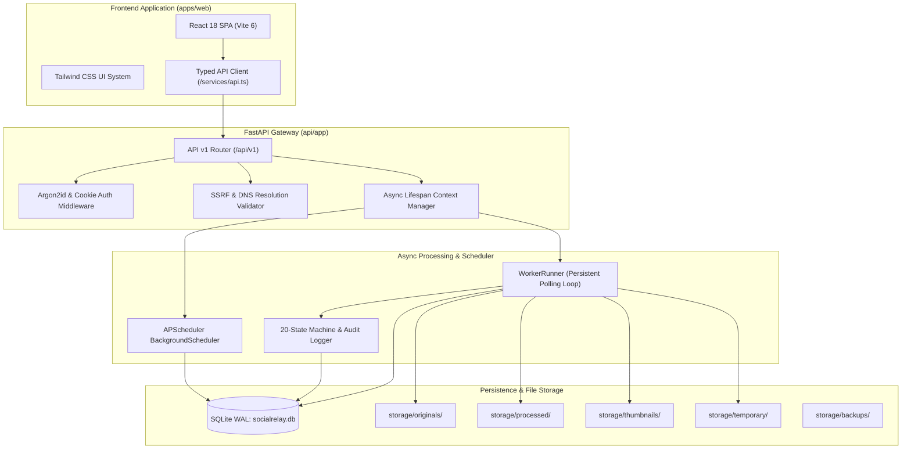

# Technical Requirements Document (TRD) — SocialRelay

**Project Name**: SocialRelay  
**Version**: 1.0.0  
**Technology Architecture**: FastAPI + React 18 + SQLite (WAL) + FFmpeg 7.1  

---

## 1. System Requirements & Hardware Specifications

### Minimum Host Requirements
- **CPU**: 2 Cores (x86_64 or ARM64)
- **RAM**: 2 GB (4 GB recommended if running local Ollama AI model)
- **Disk Space**: 10 GB available disk space for media storage and database
- **Operating System**: Windows 10/11, Ubuntu 22.04+ LTS, Debian 12, or macOS 13+
- **Network**: Internet connection with outbound access to `googleapis.com` and `graph.facebook.com`

### Runtime Dependencies
- **Python**: 3.11+ (verified on Python 3.14.7)
- **Node.js**: 20+ (verified on Node.js v24.19.0)
- **FFmpeg**: Version 7.1 (bundled via `imageio-ffmpeg` or system binary)
- **Database**: SQLite 3.35+ with WAL mode and foreign key support

---

## 2. Software Architecture & Components



---

## 3. Component Technical Specifications

### 3.1. Database Engine & Connection Strategy
- **Driver**: SQLite 3 using SQLAlchemy 2.0.
- **Connection Configuration**:
  ```python
  PRAGMA foreign_keys = ON;
  PRAGMA journal_mode = WAL;
  PRAGMA synchronous = NORMAL;
  PRAGMA busy_timeout = 30000;
  ```
- **Concurrency**: WAL mode allows concurrent readers while a single writer thread commits transactional updates without locking readers.

### 3.2. Background Worker & Queue
- **Queue Table**: `jobs` table persists tasks with `lease_owner`, `lease_expiry`, and `heartbeat_at`.
- **Atomic Lease Lock**:
  ```sql
  UPDATE jobs 
  SET lease_owner = :worker_id, 
      lease_expiry = datetime('now', '+300 seconds'),
      status = 'UPLOADING'
  WHERE id = (
      SELECT id FROM jobs 
      WHERE status IN ('QUEUED', 'RETRY_PENDING') 
        AND run_at <= datetime('now')
        AND (lease_owner IS NULL OR lease_expiry < datetime('now'))
      ORDER BY run_at ASC LIMIT 1
  );
  ```
- **Deadlock Recovery**: Any job with `lease_expiry < now()` is automatically recovered back to `QUEUED` every 60 seconds.

### 3.3. Video Processing Pipeline (FFmpeg 7.1)
- **Probe Parser**: Extracts stream details from FFmpeg banner and stream descriptors using safe regular expressions.
- **Re-Encoding Arguments**:
  ```bash
  ffmpeg -v error -y -i input.mp4 \
    -vf "scale=1080:1920:force_original_aspect_ratio=decrease,pad=1080:1920:(ow-iw)/2:(oh-ih)/2" \
    -c:v libx264 -preset fast -crf 22 -pix_fmt yuv420p \
    -c:a aac -b:a 192k -ar 44100 \
    -movflags +faststart output.mp4
  ```

### 3.4. Cryptography & Security
- **Passwords**: Hashed with Argon2id (`time_cost=3`, `memory_cost=65536`, `parallelism=4`, `salt_len=16`).
- **OAuth Tokens**: Encrypted at rest via Fernet (AES-128-CBC + HMAC-SHA256) with a master key derived deterministically or loaded from `ENCRYPTION_MASTER_KEY`.
- **SSRF Protection**: Uses `socket.getaddrinfo()` to resolve domain IPs and blocks `ipaddress.is_private`, loopback (`127.0.0.0/8`), and cloud metadata (`169.254.169.254`).

---

## 4. Platform API Integration Contracts

### 4.1. YouTube Data API v3
- **Endpoints Used**:
  - `GET /youtube/v3/channels?part=snippet&mine=true`
  - `POST /upload/youtube/v3/videos?uploadType=resumable&part=snippet,status`
- **Chunk Size**: 5,242,880 bytes (5 MB chunks) for resumable video stream upload.
- **Quota Cost**: Video insert costs 1,600 units (Daily default quota: 10,000 units ≈ 6 uploads/day).

### 4.2. Meta Graph API v21.0
- **Reel Publishing Flow**:
  1. `POST /v21.0/{ig_user_id}/media` with `media_type=REELS` and `video_url`
  2. Polling `GET /v21.0/{container_id}?fields=status_code` every 8s until `FINISHED`
  3. `POST /v21.0/{ig_user_id}/media_publish` with `creation_id`
  4. Query `GET /v21.0/{media_id}?fields=permalink`

---

## 5. Capacity & Storage Estimator

| Scenario | Imported/Mo | Retained Storage | Bandwidth/Mo |
|---|---|---|---|
| **Light** (2 videos/day) | 60 videos | 3.0 GB | 4.5 GB |
| **Standard** (5 videos/day) | 150 videos | 7.5 GB | 11.25 GB |
| **High Volume** (10 videos/day) | 300 videos | 15.0 GB | 22.5 GB |

*Assumes average video size of 25 MB, retaining 1 original and 1 processed copy for 30 days.*
