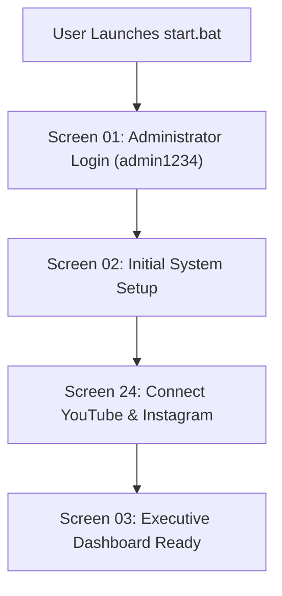
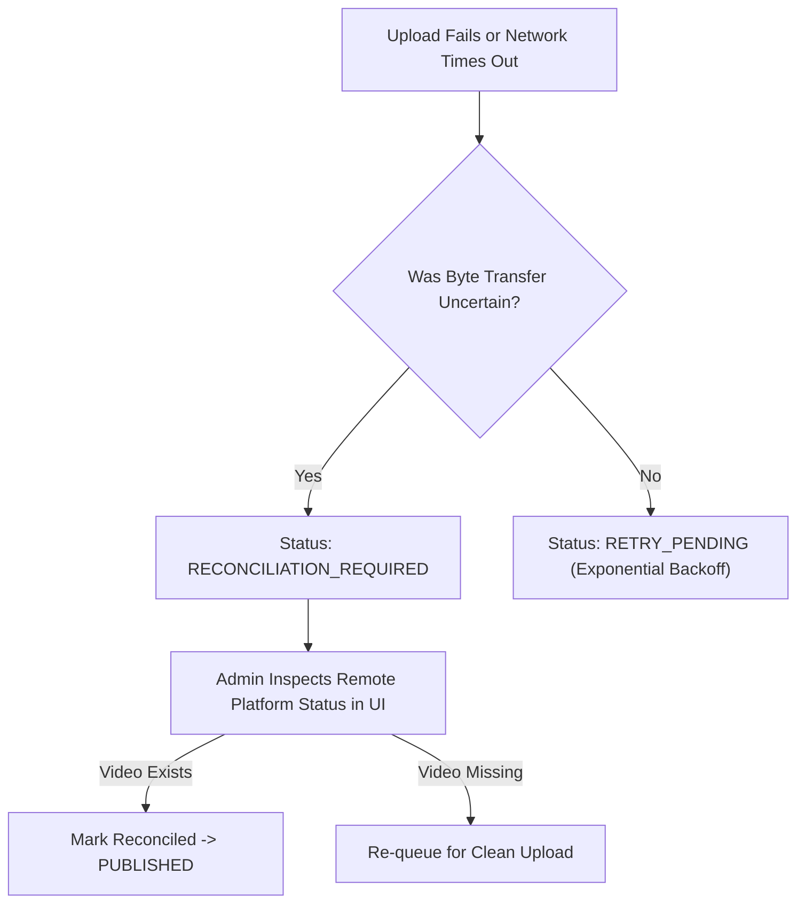

# User Journeys & Interface Flows — SocialRelay

This document details the primary user workflows across the 31 functional screens of SocialRelay.

---

## 1. Onboarding & First-Time Setup Journey

---

## 2. New Post Creation & Cross-Publishing Flow

The 4-stage interfacial flow for creating and publishing content:

```mermaid
flowchart LR
    subgraph Step1 ["Step 1: Import"]
        I1["Paste Reel URL or Upload MP4"]
        I2["Rights Confirmation Checkbox"]
    end

    subgraph Step2 ["Step 2: Content Studio"]
        E1["Inspect 9:16 Video Preview"]
        E2["Select Metadata Rule (First Sentence, Cleanup, AI)"]
        E3["Review Character (≤100) and Byte (≤5000) Counters"]
    end

    subgraph Step3 ["Step 3: Channels & Settings"]
        C1["Select Destination Accounts"]
        C2["Configure Privacy (Private/Unlisted/Public)"]
        C3["Set Schedule Date/Time or Immediate"]
    end

    subgraph Step4 ["Step 4: Dispatch & Verification"]
        D1["Enqueue Idempotent Publication Targets"]
        D2["Track Real-Time Progress"]
        D3["Verify Returned Platform URLs"]
    end

    Step1 --> Step2
    Step2 --> Step3
    Step3 --> Step4
```

---

## 3. Rescheduling via Content Calendar Flow

1. Open **Calendar** from navigation.
2. Select **Month**, **Week**, or **Day** view.
3. Click any scheduled video card to open the **Publication Modal**.
4. Adjust date/time or click **Cancel Schedule** to restore to draft.
5. Published posts display verified platform links and cannot be altered as drafts.

---

## 4. Failed Job Recovery & Reconciliation Flow

